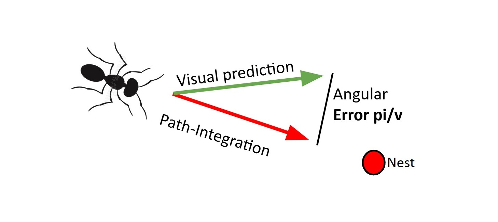
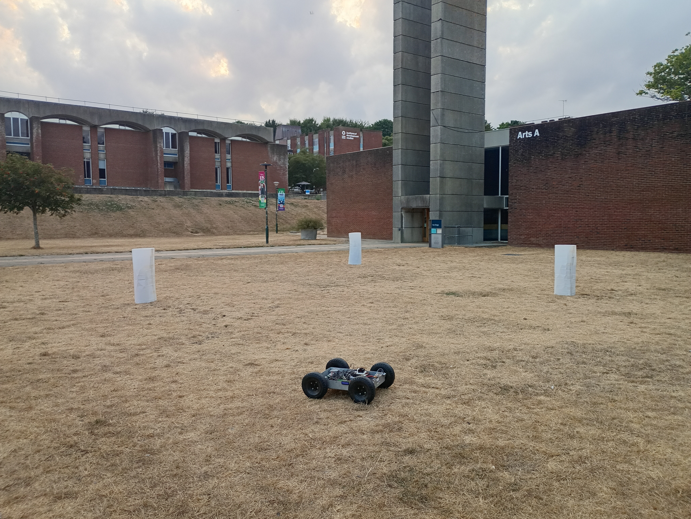
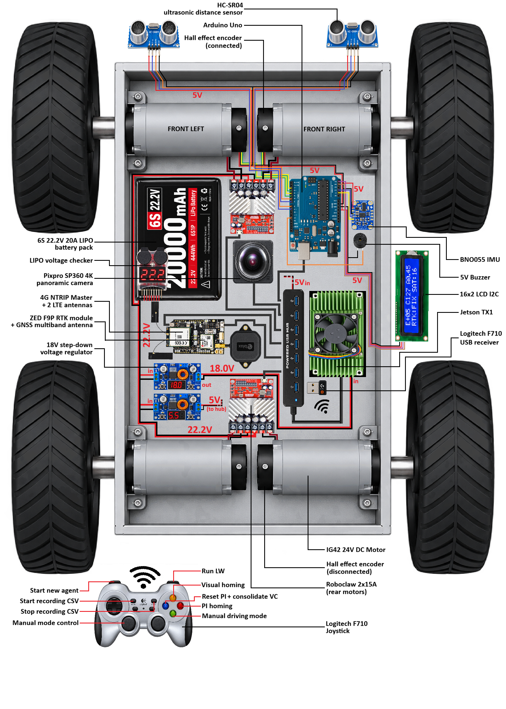
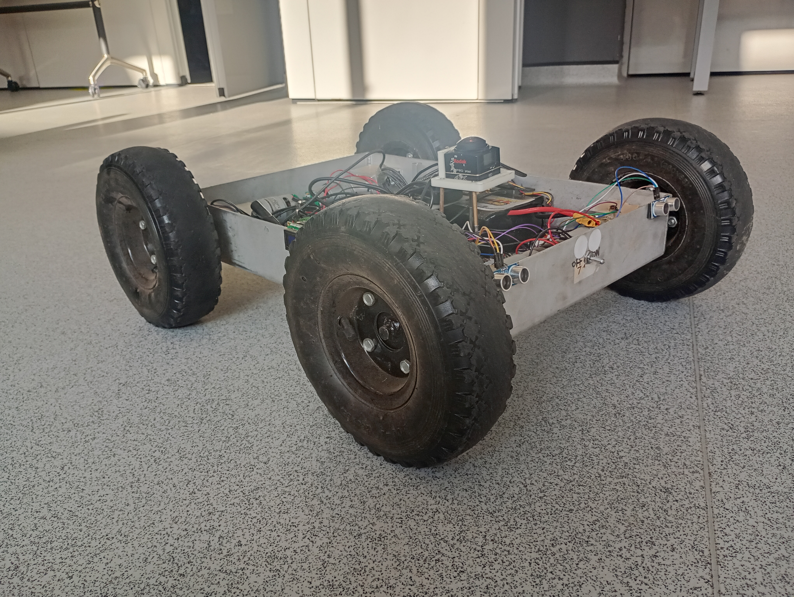
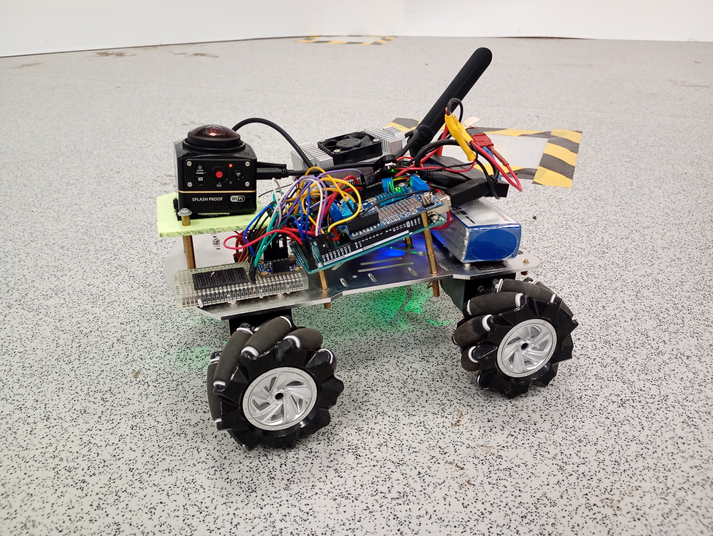
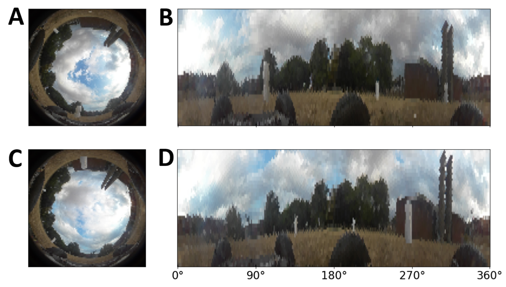
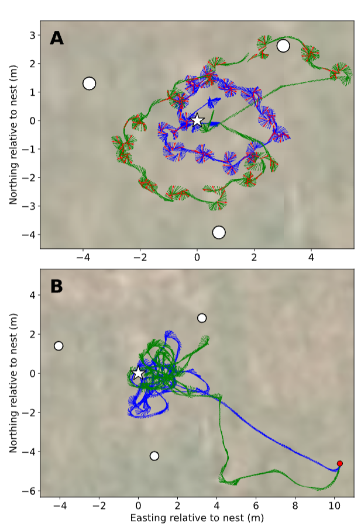
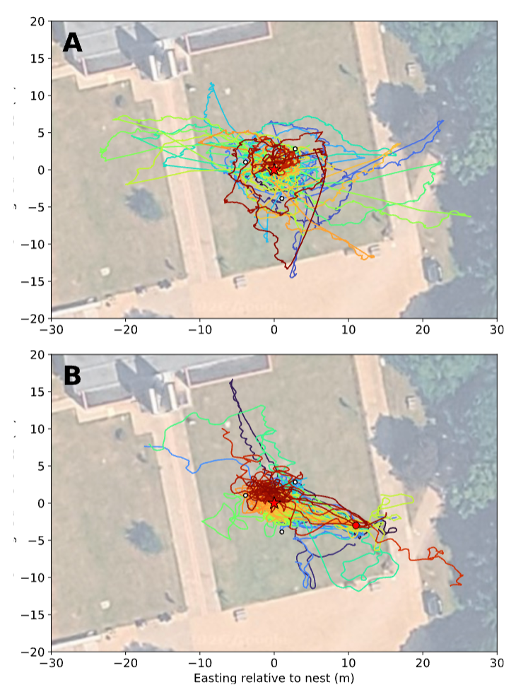

# Emergent Control of Ant Learning Walks in a Mobile Robot

This repository contains the robotic implementation of an insect-inspired model of desert ant **learning walks (LWs)**.  **Read the published paper: [Emergent Control of Ant Learning Walks in a Mobile Robot (Misiek et al., 2026) — arXiv:2611.00392](https://arxiv.org/abs/2611.00392)** Before starting to forage, naive ants explore the surroundings of their nest through short, spiralling walks, interspersed with **pirouettes** during which they scan and learn the visual panorama. Successive walks become longer and straighter as the ants acquire visual memories.

The model proposes that a single error signal—the **angular mismatch between the nest direction estimated by path integration (PI) and the direction predicted by a visual compass (VC)**—controls the balance between exploration and exploitation. Large errors promote slow movement, frequent scans and early returns to the nest. As visual memories accumulate, the mismatch decreases, allowing longer, straighter walks and, eventually, foraging-like behaviour.

Figure 1 illustrates this error signal: PI and the visual compass provide separate predictions of the nest direction, and their angular disagreement regulates learning-walk behaviour.

*Figure 1. Angular mismatch between the nest directions predicted by path integration and the visual compass.*

The aim of this robotic implementation is to test whether the same mechanism survives the **reality gap**: real sensors, uneven terrain, wheel slippage, changing illumination and imperfect panoramic images. The associated manuscript is *Emergent Control of Ant Learning Walks in a Mobile Robot* (Misiek, Philippides, Graham and Knight, 2026; arXiv submission).

## Robotic implementation

### Experimental arena

Outdoor experiments were conducted near the Library Square at the University of Sussex. As shown in Figure 2, three white cylinders reproduce a scaled-up version of the landmark arrangement used in desert-ant learning-walk experiments.

*Figure 2. Outdoor experimental arena near the Library Square, University of Sussex, with three white cylindrical landmarks.*

### Navigation architecture

The model combines three interacting components:

1. **Path integration (PI):** estimates the nestward direction from inertial heading and wheel-encoder displacement.
2. **Visual compass (VC):** uses panoramic views and mushroom-body-inspired visual memories to predict the nestward direction.
3. **Learning-walk controller:** uses the angular mismatch between PI and VC predictions to regulate exploration, pirouettes, visual learning and the transition towards foraging.

Figure 3 shows how these navigation components interact with the robot's sensors, motor control and recording systems.

*Figure 3. Architecture of the robot's navigation and control system.*

### Robotic platforms

The software was implemented on two robotic platforms (Figure 4): a differential-drive robot used for the outdoor learning-walk experiments and an earlier, smaller platform with mecanum wheels.

<table>
  <tr>
    <td align="center" width="50%">
       
      <b>A.</b> 15 kg differential-drive robot used in the outdoor experiments.
    </td>
    <td align="center" width="50%">
       
      <b>B.</b> Earlier 1 kg platform with mecanum wheels.
    </td>
  </tr>
</table>

*Figure 4. The two robotic platforms on which the software was implemented.*

The two robots weigh approximately **15 kg** and **1 kg**, respectively. They were built for practical experimental requirements, including movement over uneven terrain, **more than four hours of autonomy**, and space for onboard computing, sensors and recording devices such as **GNSS (GPS)**. Large wheels allow the outdoor robot to travel across grass and uneven ground.

The outdoor differential-drive robot has **27 cm wheels**. Its high-level navigation and visual processing run on an **NVIDIA Jetson TX1**, with an **Arduino** handling low-level sensor acquisition and **RoboClaw** motor controllers driving the wheels. A panoramic camera provides visual input; inertial heading and wheel-encoder displacement are integrated to maintain a home vector. **RTK-GNSS (GPS) provides ground-truth positions for recording and analysis; it does not supply the robot's visual homing direction.**

The **navigation algorithms themselves can run on much smaller robots**. For example, [Gattaux et al. (2026), *Antflie: Frugal Visual Teach and Repeat on Narrow FoV Micro-Drones*](https://doi.org/10.1109/LRA.2026.3667486) demonstrated a closely related **mushroom-body-inspired visual-memory navigation model** on a **33 g Crazyflie 2.1-based drone**, with the neural-network computation performed offboard during the experiments. A complete **onboard visual-navigation and path-integration pipeline** has also been demonstrated on a small quadcopter by [Ou et al. (2026)](https://doi.org/10.1038/s41586-026-10461-3). These are distinct navigation systems; neither implements the PI–VC mismatch controller for ant learning walks used here.

### Panoramic vision

The visual compass learns from images acquired by the robot's panoramic camera. Figure 5 compares raw fisheye images with their unwrapped panoramic representations. The views were acquired at different positions and times, illustrating shifts in nearby landmarks and changes in the appearance of the scene.

*Figure 5. Raw fisheye images (A, C) and their corresponding unwrapped panoramic views (B, D), acquired at different positions and times.*

## Experimental results

The robot autonomously selects when to explore, perform pirouettes, acquire visual memories and return towards the nest. Across successive walks, exploration gives way to longer, straighter trajectories as the visual compass becomes more reliable. The acquired memories also support subsequent visual homing.

Figure 6 shows representative trajectories recorded during the outdoor experiments, including exploratory paths around the nest and the artificial landmarks.

*Figure 6. Examples of learning-walk trajectories recorded during outdoor experiments.*

Figure 7 gives an overview of the recorded learning walks and the subsequent **zero-vector visual homing tests**, plotted separately over the experimental site.

*Figure 7. Outdoor trajectories: (A) learning walks and (B) zero-vector visual homing tests.*

The experimental data (CSV files) are **publicly available in the [`data/`](data/) directory** of this repository.

## Related research

- **Robotic implementation:** Misiek, T., Philippides, A., Graham, P. & Knight, J. (2026). *Emergent Control of Ant Learning Walks in a Mobile Robot*. arXiv submission. **Public arXiv identifier/link to be added once available.**
- **Computational model of learning walks:** [Misiek, T., Philippides, A., Graham, P. & Knight, J. (2026). *Emergent control of ant learning walks using the mismatch between path-integration and visual cues.* bioRxiv.](https://doi.org/10.64898/2026.05.29.728637)
- **Insect-inspired flying robot:** [Gattaux et al. (2026). *Antflie: Frugal Visual Teach and Repeat on Narrow FoV Micro-Drones.*](https://doi.org/10.1109/LRA.2026.3667486)
- **Long-range visual homing in a drone:** [Ou, D. et al. (2026). *Efficient robot navigation inspired by honeybee learning flights.* Nature 653, 1039–1046.](https://doi.org/10.1038/s41586-026-10461-3)

## Next step: learning flights in flying robots

The next step is to transfer this error-driven model of **active visual learning** to flying robots, to investigate the learning flights (LFs) of **bees and wasps**. As with ant learning walks, the aim is not only to demonstrate that memories acquired near the nest can later support homing, but to explain **when and where the animal acquires those memories, how its exploratory trajectory is controlled, and how learning gives way to foraging**.

Recent results show that insect-inspired visual homing can operate over much longer distances than those tested here. In [Ou et al. (2026)](https://doi.org/10.1038/s41586-026-10461-3), the *Bee-Nav* quadcopter combined path integration with a compact visual homing network, achieving homing to within **0.5 m** on **100% of 30–110 m flights** and **70% of 200–600 m flights** in the reported experiments. The visual networks occupied only **3.4 kB** or **42.3 kB** of memory and ran on a Raspberry Pi 4.

Importantly, although its learning flights were executed autonomously, *Bee-Nav* used a **predefined, algorithmically generated “wasp-like” trajectory** to collect visual memories. The authors explicitly state that they did not reproduce the varying learning-flight trajectories of real honeybees. Thus, their work demonstrates efficient acquisition and use of visual memories for homing, but **not a biologically motivated online mechanism controlling the structure and progression of learning flights**.

---

**Author:** Thomas Misiek · University of Sussex, UK
